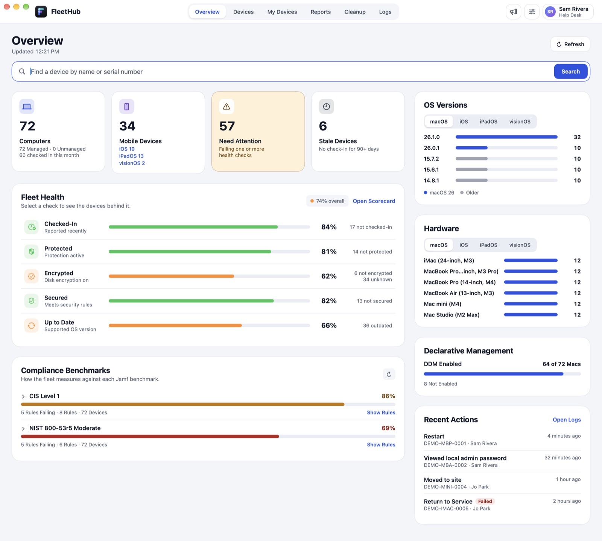
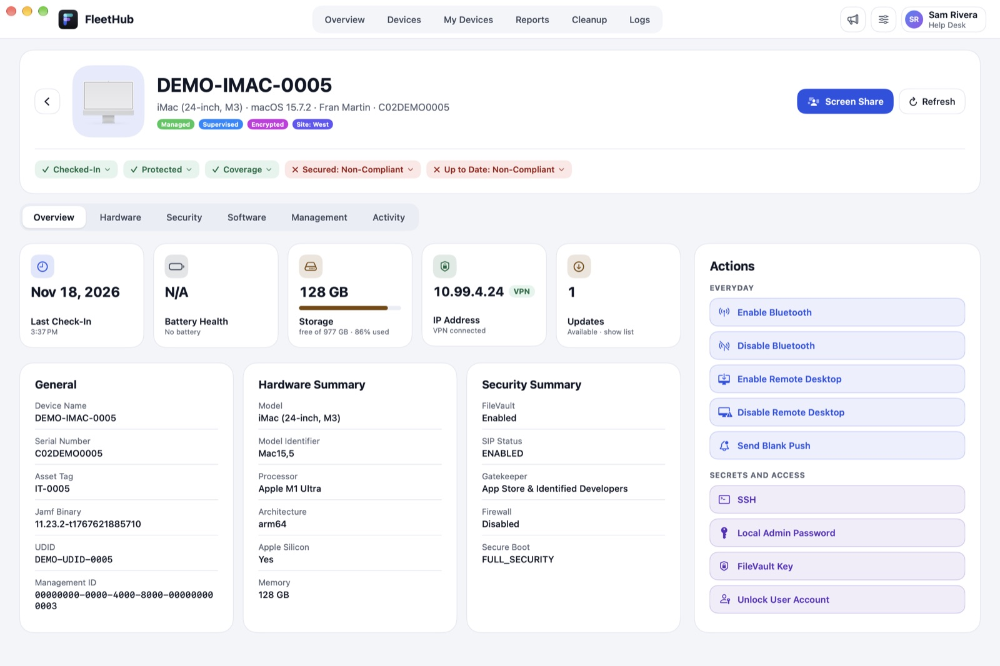

# FleetHub

FleetHub is a native Mac app for IT teams that manage Apple devices with **Jamf Pro**. A
technician can find a device, see its health, and act on it without opening the Jamf Pro
console. Every person signs in as themselves, sees only what their role allows, and every
action is logged.



> macOS 14.0 or later · SwiftUI · Apache 2.0

## What It Does

- **Overview:** device counts, five fleet health checks, Jamf Compliance Benchmarks, OS versions,
  hardware models and recent actions.
- **Devices:** search and filter Macs, iPhones, iPads and Vision Pro devices; look up devices in
  Apple Business Manager; manage PreStage assignments.
- **Device page:** hardware, security, compliance, software, management and activity for one
  device, with the actions the signed-in role may take.
- **Actions:** restart, shut down, Bluetooth and Remote Desktop, blank push, local admin
  password, FileVault key, unlock account, move to site, erase, and Return to Service.
- **Remote sessions:** Screen Share, and SSH in a FleetHub terminal window signed in as the
  Mac's management account.
- **Reports:** a Health Scorecard and a report builder with saved reports and export.
- **Cleanup:** find stale devices and act on them in bulk, in Jamf Pro and Jamf Protect.
- **My Devices:** a read-only view of the signed-in person's own devices.
- **Sites:** optionally limit each role to the devices in its Jamf Pro sites, with a site
  switcher for people who look after more than one. FleetHub applies this limit, not Jamf Pro.
- **Logs:** who did what, to which device, and whether it worked.



The screenshots show sample data.

## What Is in This Repository

| Target | What It Is |
| --- | --- |
| `FleetHub` | The main app. |
| `FleetHubMenuBar` | A menu bar companion for quick search. It ships inside `FleetHub.app` and starts at login. |
| `FleetHubSetup` | A guided app for the Jamf admin. It produces the configuration profiles, lists the Jamf privileges each role needs, and can upload the profiles and the credential script to Jamf Pro. |

## How It Fits Together

- **Settings come from configuration profiles.** FleetHub reads four managed preference
  domains. Nothing is configured in the app, and no role names are built in.
- **Secrets never come from a profile.** They are typed into the app or delivered by a Jamf
  policy, and are kept in each person's Keychain.
- **People sign in** with Microsoft Entra ID, or with an email address in single-operator
  setups. Configuring Entra sign-in turns email sign-in off. Their role decides which tabs and actions they see.
- **Actions run as the person.** Each operator has their own Jamf Pro API client, which
  FleetHub can create for them or an administrator can create ahead of time, so Jamf's audit
  log names the person, not a shared account.
- **Two Jamf APIs are supported:** the Jamf Pro API, the Jamf Platform API, or a hybrid of both.

## Requirements

- macOS 14.0 (Sonoma) or later on the technician's Mac
- A Jamf Pro tenant, and permission to create API roles and clients in it
- Xcode 16 or later to build
- An Apple Developer ID to sign and notarize a package for deployment

Optional: Microsoft Entra ID for sign-in, Apple Business Manager API access, Jamf Protect, and
a Jamf Platform API integration (needed for Compliance Benchmarks).

## Getting Started

[`docs/SetupGuide.md`](docs/SetupGuide.md) is the full walkthrough, from download to a working
install, including what to create in Jamf Pro and in each optional service. In outline:

1. **Build and sign a package.** See [`Deployment/README.md`](Deployment/README.md).
2. **Run FleetHub Setup.** It walks through the four settings domains and shows the exact Jamf
   privileges each API client and role needs.
3. **Create the API roles and clients in Jamf Pro** that Setup lists.
4. **Deliver the four configuration profiles.** Setup can export them or upload them to Jamf Pro,
   unscoped, for you to scope.
5. **Deliver the secrets.** Type them into the app, or use the Jamf policy script described in
   [`docs/CredentialDelivery.md`](docs/CredentialDelivery.md).
6. **Install FleetHub and sign in.**

## Configuration

FleetHub reads four preference domains, each delivered as its own Jamf *Application & Custom
Settings* profile. Changes take effect when the app is relaunched.

| Domain | Contents |
| --- | --- |
| `com.herojoneslabs.fleethub.core` | Jamf connection, sign-in method, and the non-secret identities of the integrations |
| `com.herojoneslabs.fleethub.access` | Roles: which tabs, actions, sites and servers each one may use |
| `com.herojoneslabs.fleethub.features` | Feature switches and tuning, including the Health Scorecard |
| `com.herojoneslabs.fleethub.ui` | Branding and appearance |

The JSON schemas in [`schemas/`](schemas/) are the authoritative list of keys and load directly
into Jamf Pro's custom schema form. [`docs/Configuration.md`](docs/Configuration.md) explains
how the domains fit together, how to scope them, and how to check the result.

## Security Model

- **Fail closed.** A missing profile, role or privilege removes the feature. It never falls back
  to a wider permission.
- **Role gating is checked twice:** when the interface is built, and again before any action runs.
- **Destructive actions** (Erase, Return to Service) need two confirmations and a typed word.
- **Secrets** live in the Keychain and are never written to preferences, logs or profiles.

Known limits to weigh before you deploy:

- **Automatic API client creation needs a powerful secret.** It is off by default: you create
  each operator's API client in Jamf Pro, and they enter it in FleetHub once. If you turn it on
  (`authentication.autoCreateUserApiClient` = true, or the switch in FleetHub Setup), FleetHub
  creates each operator's client itself. To do that it keeps a provisioning ("master") client
  secret on every Mac it runs on, and someone who extracts it from their own Keychain could
  create a Jamf API client with any API role in your tenant.
- **Email sign-in does not prove identity.** It accepts whatever address is typed. With Entra
  sign-in the identity comes from Microsoft and cannot be typed in, so this does not apply.
  FleetHub refuses email sign-in while automatic creation is on, so under email sign-in each
  person must hold their own API client's secret, and Jamf's audit log still names who acted.
- **The system log keeps values private.** FleetHub's diagnostic messages record their fixed
  wording only; device names, serial numbers, usernames, identifiers and error text are stored
  as private data, which macOS shows only on a Mac set up to reveal it. Passwords, keys and
  tokens are never logged at all. Messages printed by debug builds are not redacted.
- **The Jamf Platform API paths have not been verified against a live tenant.** See
  [`docs/PlatformAPI.md`](docs/PlatformAPI.md).

To report a security problem, please open a private security advisory on this repository rather
than a public issue.

## Documentation

| Document | For |
| --- | --- |
| [`docs/FleetHub-User-Guide.pdf`](docs/FleetHub-User-Guide.pdf) | Technicians: how to use the app, with screenshots |
| [`docs/SetupGuide.md`](docs/SetupGuide.md) | Jamf administrators: the whole setup, start to finish, with troubleshooting |
| [`docs/Integrations.md`](docs/Integrations.md) | What Apple Business Manager, Entra device cleanup, Jamf Protect, Jamf LAPS, SSH and Screen Share each need |
| [`Deployment/README.md`](Deployment/README.md) | Building the package and deploying it with Jamf |
| [`docs/Configuration.md`](docs/Configuration.md) | The four settings domains, scoping and verification |
| [`docs/EntraAuthSetup.md`](docs/EntraAuthSetup.md) | Setting up Microsoft Entra ID sign-in |
| [`docs/JamfAPIPrivileges.md`](docs/JamfAPIPrivileges.md) | The Jamf Pro API privileges each function needs |
| [`docs/PlatformAPI.md`](docs/PlatformAPI.md) | Using the Jamf Platform API, and what is unverified |
| [`docs/CredentialDelivery.md`](docs/CredentialDelivery.md) | Delivering secrets to the Keychain with a Jamf policy |
| [`docs/Features.md`](docs/Features.md) | Health card scope, report filters, Screen Share and SSH |

## Building From Source

```sh
open FleetHub.xcodeproj
```

or, from the command line, without code signing:

```sh
xcodebuild build -project FleetHub.xcodeproj -scheme FleetHub \
  -destination 'platform=macOS' CODE_SIGNING_ALLOWED=NO
```

The schemes are `FleetHub`, `FleetHubMenuBar` and `FleetHubSetup`. The project has one package
dependency, [SwiftTerm](https://github.com/migueldeicaza/SwiftTerm), pinned to an exact version.

**Trying it without a Jamf tenant.** A Debug build started with the `-FleetHubDemo` launch
argument skips sign-in and shows generated sample data. Demo mode is compiled out of Release
builds and cannot reach a real tenant.

For development against a real tenant, write settings into the preference domains with
`defaults write`, as described in [`docs/Configuration.md`](docs/Configuration.md), then enter
the secrets in the app. Never commit real credentials.

## Project Status

FleetHub is maintained by one person and has no automated tests yet. CI builds all three
schemes on every pull request. Treat the Jamf Platform API support as experimental.

## Contributing

Changes land through pull requests and must pass CI. See
[`.github/PULL_REQUEST_TEMPLATE.md`](.github/PULL_REQUEST_TEMPLATE.md).

## License

Apache License 2.0. See [`LICENSE`](LICENSE) and [`NOTICE`](NOTICE).
